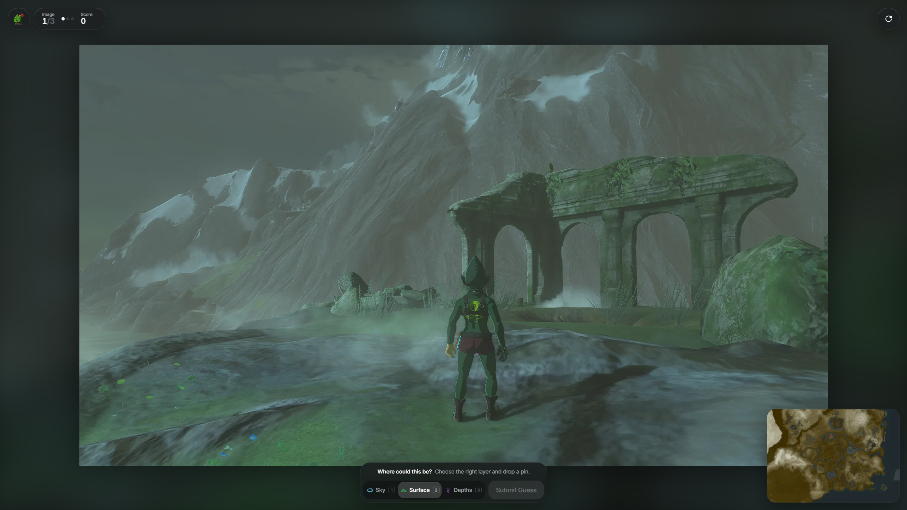

# TotK Guesser


**TotK Guesser** is GeoGuessr for **Hyrule**. You get a screenshot from somewhere in *The Legend of Zelda: Tears of the Kingdom* and have to find the spot on the map: on the **Surface**, up on the **Sky Islands** or down in the **Depths**. The closer your pin, the more points you get.

▶ **Play it here: [knaxas.github.io/totk-guesser](https://knaxas.github.io/totk-guesser/)**



---

## 🎮 How to play

1. Look closely at the screenshot. Scroll or pinch to zoom in, drag to look around.
2. Pick the right layer: **Sky**, **Surface** or **Depths**.
3. Drop your pin on the map and hit **Submit**.

Each image is worth up to **5,000 points**. Anything within ~90 m counts as a perfect guess. A pin on the wrong layer scores **0**.

### Difficulty

| Difficulty | Layers in the game |
|---|---|
| 🟢 Easy | Surface only |
| 🟡 Medium | Surface and Sky Islands |
| 🔴 Hard | Surface, Sky Islands and Depths |

You can play **3 to 15 rounds** per game.

### Challenge your friends

Every game has a **seed**: a short list of numbers that stands for its exact images. Copy the challenge link from the start page or from the results screen and send it to a friend. They get the same images and you can compare scores. You can also paste a seed or a whole link into the seed field on the start page.

### Keyboard shortcuts

| Key | Action |
|---|---|
| `Space` / `Enter` | Submit guess / next image |
| `1` `2` `3` | Switch to Sky / Surface / Depths |
| `M` | Keep the map open (pin it) |
| `Esc` | Close the map |

## ✨ Features

- **Three map layers**: Surface, Sky Islands and Depths
- **Zoomable screenshots**: mouse wheel, drag, double-click, pinch and double-tap
- **Works on phones**: touch-friendly layout with a map you tap to open
- **Shareable seeds** to challenge friends with the same images
- **Result screen** with your rank, a round-by-round breakdown and your **personal best** per difficulty and round count
- **Resume after reload**: if you refresh by accident, your game continues where it was
- **Fresh images**: random games favour images you haven't seen recently
- **Installable**: add it to your home screen or install it as an app (web app manifest + icons)

## 🛠 Running it locally

It's a plain static website. There is no build step and no dependencies to install. The game loads `locations.json` with `fetch`, so it has to run on a web server. Opening `index.html` straight from disk won't work. For example:

```bash
# in the project folder
python -m http.server 8000
# then open http://localhost:8000
```

### Project structure

```
index.html            start page (seed, rounds, difficulty)
guess.html            the game
credits.html          credits
play/shared.js        shared logic: locations, seeds, difficulty, random games
play/app.js           game logic: map, scoring, image zoom, result screen
play/app.css          game styles
assets/images/locations/
    locations.json    image -> "layer_x_y"
    imgN.png          original screenshots (fallback)
    webp/imgN.webp    compressed screenshots (used by the game)
assets/images/maps/
    *.jpg             original maps (6000x5000, source for the tiles)
    tiles/<layer>/    256px WebP map tiles (used by the game)
    webp/*.webp       compressed full maps (fallback if tiles are missing)
```

### Adding a new location

1. Save the screenshot as `assets/images/locations/imgN.png`, using the next free number.
2. Add a compressed copy as `assets/images/locations/webp/imgN.webp`. For example, with Python and Pillow:
   ```bash
   python -c "from PIL import Image; Image.open('assets/images/locations/imgN.png').convert('RGB').save('assets/images/locations/webp/imgN.webp', quality=82)"
   ```
   If the WebP file is missing, the game falls back to the PNG.
3. Add the location to `assets/images/locations/locations.json` as `"imgN": "<layer>_<x>_<y>"`. `<layer>` is `surface`, `sky` or `depths`, and `x`/`y` are the in-game map coordinates.

## 💡 Inspiration

TotK Guesser grew out of [HyruleGuessr](https://hyruleguessr.com), which is itself inspired by **GeoGuessr**. I wanted to add the **Depths** and the **Sky Islands**, the two parts of Tears of the Kingdom's world that make it unique, so you can really prove that you know Hyrule.

## 📜 Credits

Made by Max and Tobias. Maps are rendered with [Leaflet](https://leafletjs.com).

TotK Guesser is a non-commercial fan project. *The Legend of Zelda: Tears of the Kingdom* and all related assets are © Nintendo.
